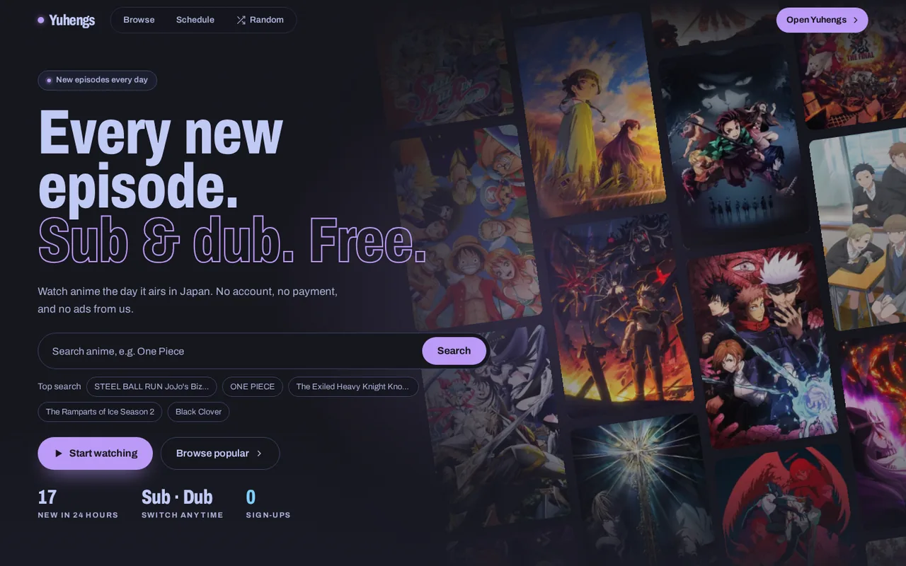
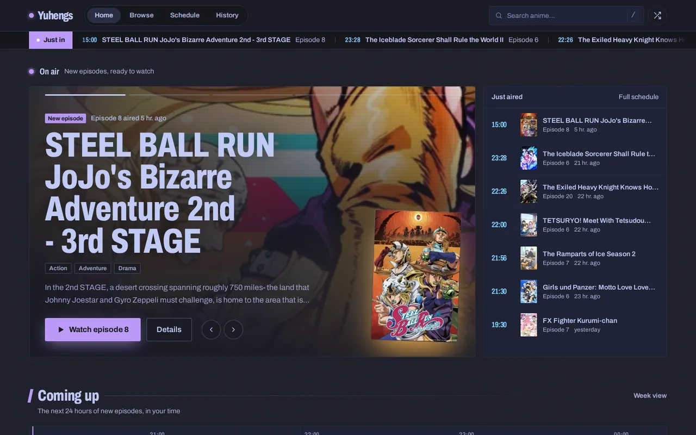
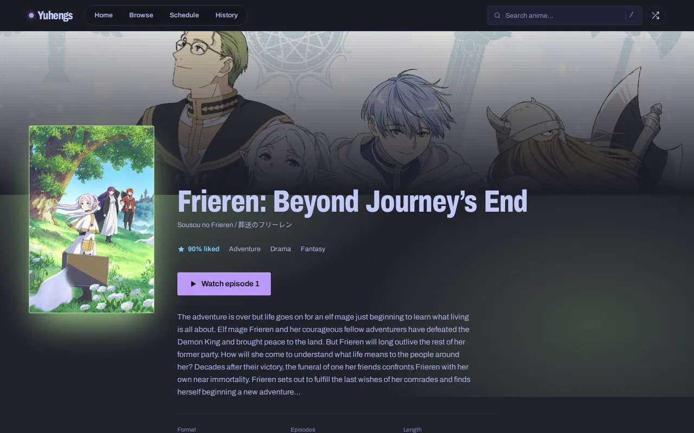
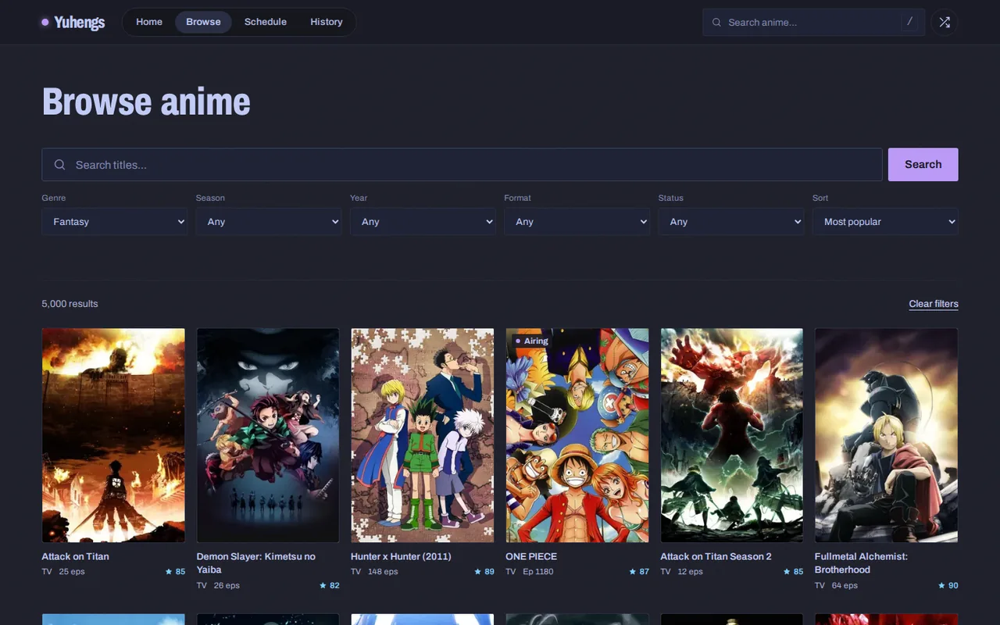
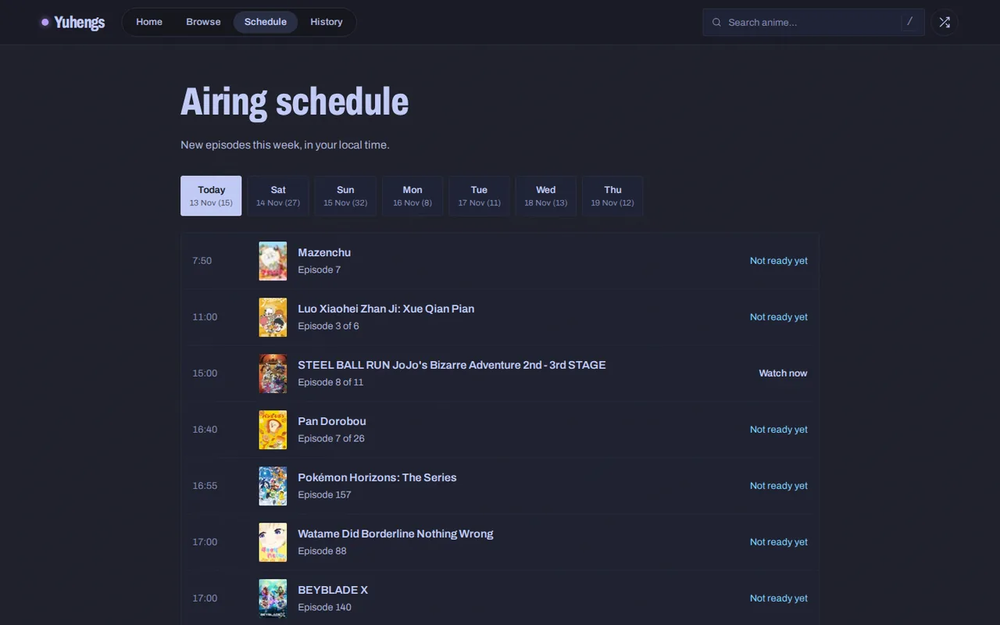
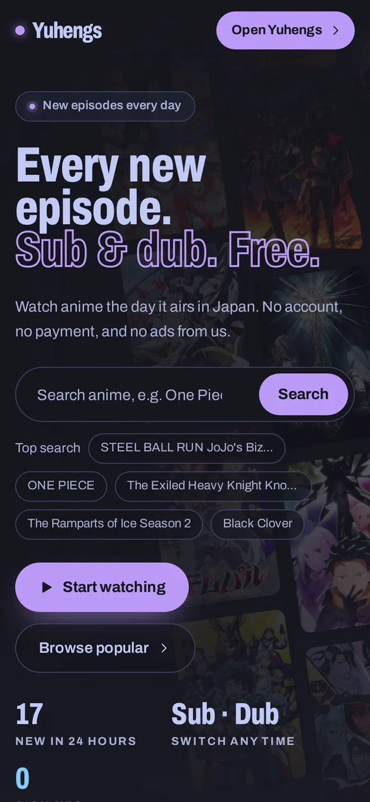
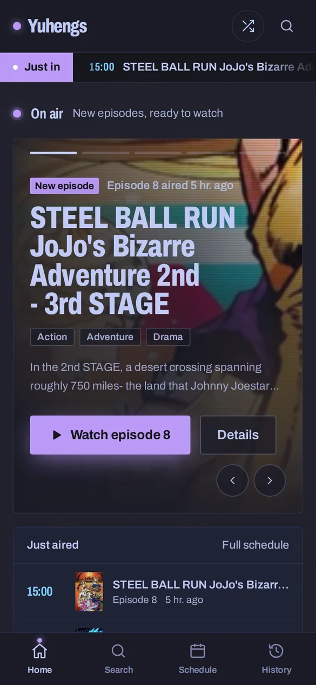

<div align="center">

# Yuhengs

**Every new episode. Sub & dub. Free.**

A non-commercial anime fan site styled like a late-night TV channel:<br>
what just aired, what's on tonight, and every other show on AniList.

[**Open the live site →**](https://yuhengs.vercel.app)




</div>

## What's inside

- **Poster-wall landing page** with search and the day's top searches
- **Dashboard** built around the broadcast day: the biggest new episode, a just-aired list, a 24-hour "Coming up" guide
- **Player** that remembers where you stopped, counts down to the next episode, and can skip intros
- **Browse and schedule**: filter by genre, season, year, format and status; see the week's airings in your own time zone
- **No accounts**: history and progress stay in your browser

## Screenshots

### Dashboard



### Anime page



<table>
  <tr>
    <td width="50%"><b>Browse</b><br></td>
    <td width="50%"><b>Schedule</b><br></td>
  </tr>
</table>

### On a phone

<p align="center">
  
  &nbsp;&nbsp;
  
</p>

## Stack

| | |
| --- | --- |
| Framework | Next.js 16 (App Router, Cache Components, Partial Prefetching), React 19 |
| Language | TypeScript |
| Styling | Tailwind CSS 4, self-hosted Archivo variable font |
| Data | [AniList GraphQL API](https://docs.anilist.co) |
| Video | Third-party embed servers (nothing is hosted here) |
| Hosting | Vercel, Singapore region (`sin1`) |

## Run it

Needs Node.js 20 or newer.

```bash
npm install
npm run dev        # http://localhost:3000
npm run dev:lan    # HTTPS on your local network, for testing on a phone
npm run dev:clean  # clears the dev cache first; use it if styles look out of date
npm run build && npm start
npm run lint
```

| Variable | Needed | What it does |
| --- | --- | --- |
| `NEXT_PUBLIC_SITE_URL` | Optional | The deployed URL, so link previews on social media resolve |

## Pages

| Route | What it shows |
| --- | --- |
| `/` | Landing page: full-screen poster wall, search, how it works, FAQ, and "Open Yuhengs" into the dashboard |
| `/home` | Dashboard: on air now, just aired, coming up in the next 24 hours, continue watching, seasonal / trending / popular / top-rated rows |
| `/search` | Search with genre, season, year, format, status and sort filters, all kept in the URL |
| `/anime/[id]` | Details, the episodes ready to watch, related titles and recommendations |
| `/watch/[id]/[episode]` | Player with server and sub/dub switching, episode list, previous and next |
| `/schedule` | This week's airings in the viewer's local time |
| `/history` | Everything watched on this device |
| `/random` | Jumps to a random popular anime (the shuffle button in the header) |

## How it works

### Data and caching

All anime data comes from AniList through [`src/lib/anilist.ts`](src/lib/anilist.ts). Queries are cached with Cache Components (`"use cache"` with `cacheLife`): the airing schedule refreshes every few minutes, collections and details every hour, the random pool daily. Pages render a static shell first and stream in what needs the request.

### Streaming servers

[`src/lib/providers.ts`](src/lib/providers.ts) lists the embed servers, keyed by AniList id, in fallback order:

1. **MegaPlay** (default): its controls respond on the first tap. It needs a secure page (HTTPS or localhost), which is why `dev:lan` serves HTTPS.
2. **AniEmbed**: runs in a sandboxed iframe so its ad layer can't open pop-ups.
3. **VidNest**

Third-party embeds break without notice. When one stops working, re-test it and update that file; the comment there records what was tested and what was removed.

[`src/lib/availability.ts`](src/lib/availability.ts) checks which episodes the servers actually have before offering them, so the site never links to an empty player.

### Player extras

[`src/lib/embed-bridge.ts`](src/lib/embed-bridge.ts) holds each server's `postMessage` protocol, read from the players' own scripts. It powers:

- resuming where you stopped, with a "Start over" option
- the next-episode countdown near the end of an episode
- MegaPlay's skip-intro

Every message is optional: a server that changes its format only loses these extras, never playback.

### Security

[`next.config.ts`](next.config.ts) sets the security headers. The Content Security Policy only allows the streaming servers in iframes (the `frame-src` list is built from the server list, so the two can't drift apart) and stops other sites from framing Yuhengs.

### Saved in the browser

Watch history, your place in each episode and player preferences live in `localStorage` ([`src/lib/history.ts`](src/lib/history.ts)). Nothing is sent to a server, and clearing history wipes all of it.

## Design

A late-night broadcast in the [Tokyo Night](https://github.com/folke/tokyonight.nvim) palette:

- night-city navy surfaces
- a lavender "on-air" tally, kept for live marks and primary actions
- cyan for air times and scores
- one typeface, Archivo, whose width axis gives both condensed titles and normal body text

Colour tokens live in [`src/app/globals.css`](src/app/globals.css). On any `bg-onair` fill use `text-on-onair`, not `text-white`: the lavender is light and needs dark text.

## Project layout

```
src/
  app/
    (landing)/        landing page with its own header
    (site)/           everything with the site header and tab bar
    random/           /random redirect
    api/episodes/     episode availability for the client
  components/         UI, one component per file
  lib/                AniList client, servers, history, formatting
scripts/dev-lan.mjs   HTTPS dev server for phones on the LAN
```

## Credits

Anime data and artwork from [AniList](https://anilist.co). Yuhengs is a non-commercial fan project and is not affiliated with AniList or any streaming provider.
